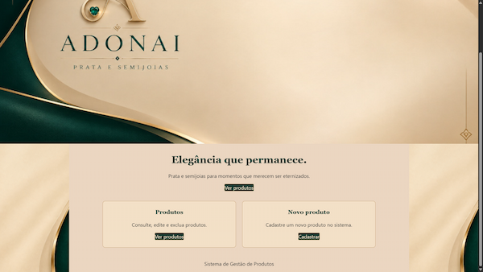
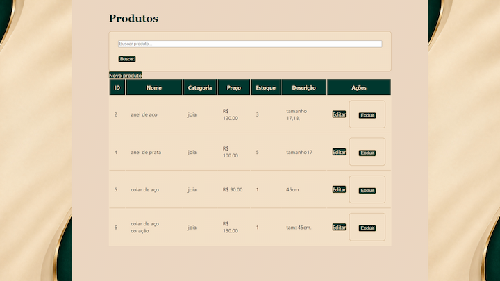
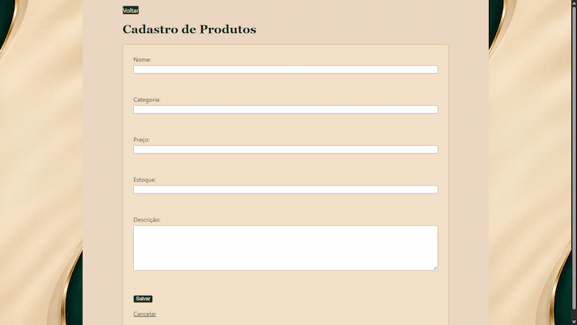

# ADONAI — Sistema de Gestão de Produtos

Aplicação web em Flask para gerenciar o catálogo de uma marca de prata e semijoias. Cadastra, edita, busca e exclui produtos, calcula o preço de venda a partir do custo com **multiplicadores configuráveis**, mostra indicadores e gráficos em um **dashboard** e protege tudo com **login e senha**.

Projeto de portfólio do curso de Análise e Desenvolvimento de Sistemas, com identidade visual própria (verde esmeralda, dourado e marfim).



## Funcionalidades

- **CRUD de produtos:** nome, categoria, custo, multiplicador, preço, estoque e descrição
- **Busca** por nome na listagem
- **Multiplicadores de preço:** o preço de venda é `custo × multiplicador`, com multiplicadores entre 1,5 e 4 e nomes definidos pelo usuário
- **Cálculo automático** do preço no formulário (JavaScript) e recálculo no servidor ao salvar
- **Dashboard** com indicadores (produtos, itens em estoque, valor do estoque e margem média) e três gráficos (estoque por produto, custo × preço e produtos por categoria)
- **Login com senha** protegida por hash, sessão com expiração e bloqueio de todas as páginas para quem não entrou
- **Validação no servidor**, com mensagens de erro e de sucesso
- **19 testes automatizados** com pytest
- **Docker** com o banco em volume, para os dados persistirem

## Telas

| Lista de produtos | Cadastro |
|---|---|
|  |  |

<!-- Depois de salvar o print do dashboard em docs/dashboard.png, apague esta linha e a do fim do comentário:

-->

## Tecnologias

- Python 3.13 e Flask
- SQLite
- Jinja2, HTML5 e CSS3 (variáveis, grid e flexbox, em módulos)
- JavaScript e Chart.js
- Docker e Docker Compose
- pytest

## Estrutura do projeto

```
CRUD de clientes (Flask)/
├── app.py               # rotas, validação, login e proteção das páginas
├── produtos.py          # banco de dados: produtos e multiplicadores
├── usuarios.py          # usuários e verificação de senha
├── templates/           # base, home, listar, form, multiplicadores, dashboard, login
├── static/
│   ├── css/             # CSS modular (main.css importa os demais)
│   ├── js/              # preco.js e dashboard.js
│   └── img/             # hero, laterais e favicons
├── tests/               # conftest.py, test_app.py, test_produtos.py
├── docs/                # prints usados no README
├── Dockerfile
├── docker-compose.yml
├── requirements.txt
├── pytest.ini
├── .env.example
└── .gitignore
```

## Como executar

### Com Docker (recomendado)

1. Copie `.env.example` para `.env` e preencha as três variáveis:

   ```
   SECRET_KEY=
   ADMIN_USER=
   ADMIN_PASSWORD=
   ```

   Para gerar a chave:

   ```
   python -c "import secrets; print(secrets.token_hex(32))"
   ```

2. Suba a aplicação:

   ```
   docker compose up --build
   ```

3. Acesse http://localhost:5001 e entre com o usuário e a senha definidos no `.env`.

O banco fica na pasta `data/`, então os dados permanecem entre execuções. O usuário administrador é criado (ou tem a senha atualizada) a cada inicialização, a partir do `.env`.

### Sem Docker

```
pip install -r requirements.txt
```

No PowerShell, defina as variáveis e inicie:

```
$env:SECRET_KEY="sua-chave"
$env:ADMIN_USER="admin"
$env:ADMIN_PASSWORD="sua-senha"
python app.py
```

Acesse http://127.0.0.1:5000

### Variáveis de ambiente

| Variável | Obrigatória | Função |
|---|---|---|
| `SECRET_KEY` | Sim | Assina a sessão; o app não inicia sem ela |
| `ADMIN_USER` | Para ter login | Nome do administrador |
| `ADMIN_PASSWORD` | Para ter login | Senha do administrador (guardada com hash) |
| `DB_PATH` | Não | Caminho do banco; no Docker é `/data/produtos.db` |
| `COOKIE_SEGURO` | Não | Use `1` quando hospedar com HTTPS |
| `FLASK_DEBUG` | Não | Use `1` para ligar o modo de depuração ao rodar `python app.py` |

## Rotas

| Rota | Método | Função |
|---|---|---|
| `/login` | GET, POST | Entrar (única página pública) |
| `/logout` | POST | Sair |
| `/` | GET | Página inicial |
| `/produtos` | GET | Lista e busca (`?q=`) |
| `/novo` | GET, POST | Cadastrar produto |
| `/editar/<id>` | GET, POST | Editar produto |
| `/excluir/<id>` | POST | Excluir produto |
| `/multiplicadores` | GET, POST | Criar e editar multiplicadores |
| `/multiplicadores/<id>/excluir` | POST | Excluir multiplicador |
| `/dashboard` | GET | Indicadores e gráficos |

## Banco de dados

| Tabela | Campos |
|---|---|
| `produtos` | id, nome, categoria, preco, estoque, descricao, custo, multiplicador |
| `multiplicadores` | id, nome, valor |
| `usuarios` | id, usuario (único), senha_hash |

Bancos criados antes dos multiplicadores recebem as colunas novas automaticamente.

## Testes

```
pip install pytest
python -m pytest -v
```

São 19 testes, que usam um banco temporário e não alteram os seus dados:

- **Banco:** criar, buscar, atualizar, excluir, busca por nome e cálculo do preço pelo multiplicador
- **Rotas:** abertura das páginas, validação de campos, redirecionamentos e formulário com os multiplicadores
- **Login:** acesso bloqueado sem login, entrada com senha correta e errada, logout e senha guardada com hash

## Segurança

**Implementado:** consultas SQL parametrizadas, senhas com hash, `SECRET_KEY` obrigatória, `.env` fora do Git, cookie de sessão `HttpOnly` e `SameSite=Lax`, sessão com expiração de 8 horas, exclusão e logout por POST, validação no servidor e mensagem única para usuário inexistente e senha errada.

**Pendente:** tokens CSRF (Flask-WTF), limite de tentativas de login, níveis de acesso e preço em centavos ou `Decimal`.

## O que aprendi

- Separar rotas (`app.py`) do acesso a dados (`produtos.py`)
- Herança de templates com Jinja2
- CSS modular com variáveis para uma identidade visual
- Migração simples de banco com `ALTER TABLE`
- Autenticação com sessão e hash de senha
- Testes automatizados, que já encontraram um defeito real (mensagens de erro que não apareciam)
- Containerização com Docker e persistência em volume
- Variáveis de ambiente para dados sensíveis

## Próximos passos

- Proteção CSRF com Flask-WTF
- Preço em centavos ou `Decimal`
- GitHub Actions rodando o pytest a cada push
- Limite de tentativas de login
- Deploy com PostgreSQL
- Reorganização com *app factory* e *blueprints*

## Autor

**Natan** — estudante de Análise e Desenvolvimento de Sistemas.
[GitHub](https://github.com/NatanjSoares)