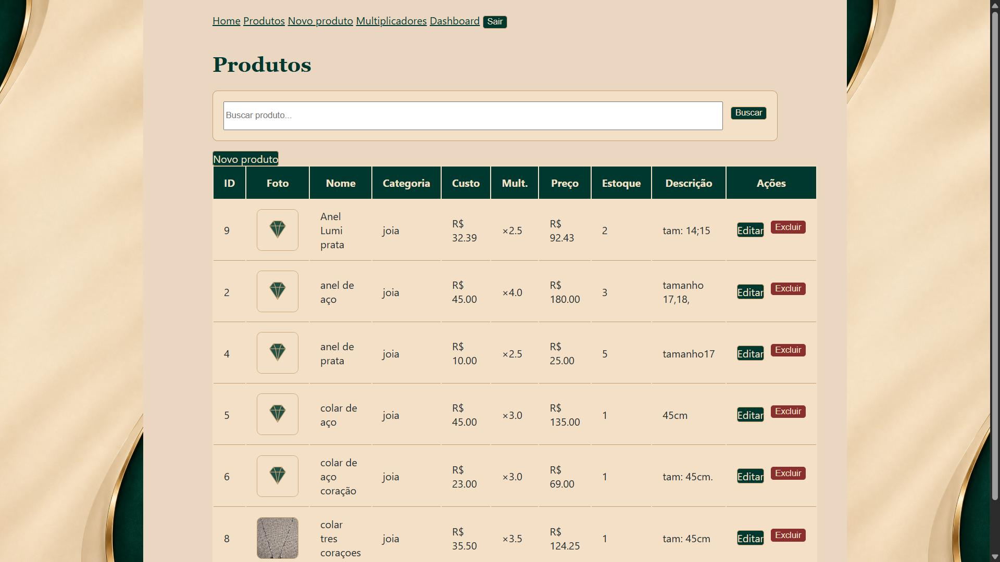
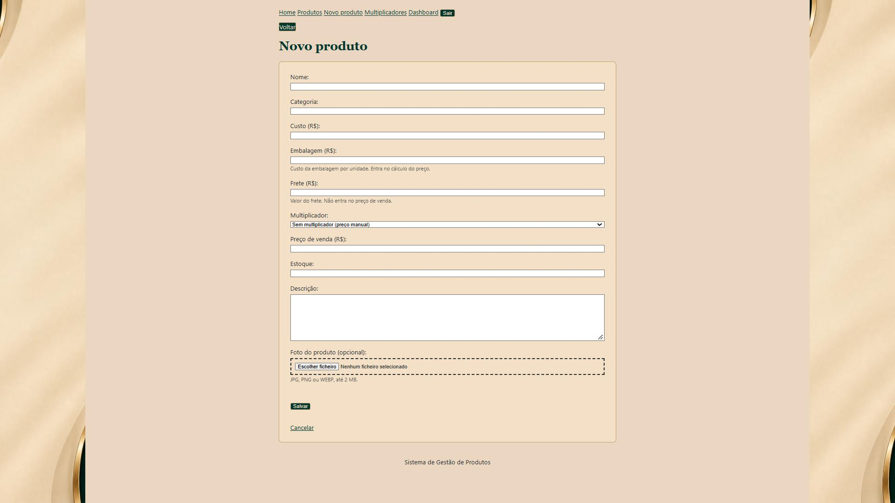
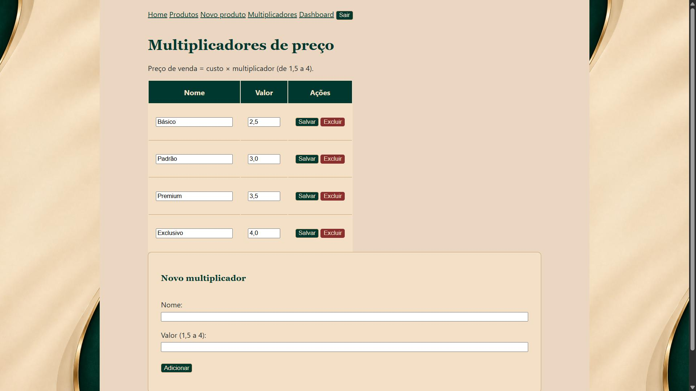
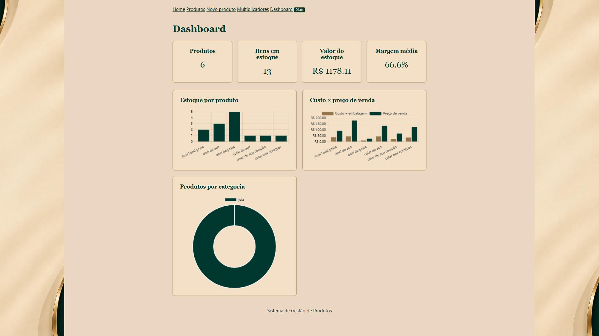

# ADONAI — Sistema de Gestão de Produtos


Área administrativa de uma marca de prata e semijoias, feita em Flask. Cadastra produtos com foto, calcula o preço de venda a partir do custo com **multiplicadores configuráveis**, mostra indicadores e gráficos em um **dashboard** e protege tudo com **login e senha**.

Projeto de portfólio do curso de Análise e Desenvolvimento de Sistemas, com identidade visual própria (verde esmeralda, dourado e marfim).


## Funcionalidades

- **CRUD de produtos:** nome, categoria, custo, embalagem, frete, multiplicador, preço de venda, estoque, descrição e foto, com busca por nome
- **Preço automático:** `(custo + embalagem) × multiplicador`, calculado na tela e recalculado no servidor ao salvar
- **Multiplicadores configuráveis** (de 1,5 a 4), com nomes definidos pelo usuário
- **Fotos dos produtos:** envio de JPG, PNG ou WEBP de até 2 MB, conferido pelo conteúdo do arquivo (não só pela extensão), nome aleatório no disco, ampliação ao clicar e imagem padrão quando não há foto
- **Dashboard:** produtos, itens em estoque, valor do estoque, margem média e três gráficos (estoque por produto, custo × preço e produtos por categoria)
- **Login com senha** guardada com hash, sessão com expiração, proteção CSRF e limite de tentativas
- **Dinheiro em centavos:** valores guardados como inteiros e calculados com `Decimal`, sem erros de arredondamento
- **Validação no servidor**, com mensagens de erro e de sucesso
- **Docker** com volumes para o banco e para as fotos
- **Testes automatizados** (136) rodando no GitHub Actions a cada push

## Telas

| Login | Home |
|---|---|
|  |  |

| Lista de produtos | Cadastro |
|---|---|
|  |  |

| Multiplicadores | Dashboard |
|---|---|
|  |  |

## Regras de preço

| Campo | Papel no cálculo |
|---|---|
| **Custo** | Base do preço |
| **Embalagem** | Custo por unidade, **somado ao custo** antes do multiplicador |
| **Multiplicador** | Multiplica `custo + embalagem` (entre 1,5 e 4) |
| **Frete** | Guardado à parte: **não** entra no preço de venda nem na margem |

Exemplo: custo R$ 20,00, embalagem R$ 5,00 e multiplicador ×2,5 resultam em preço de venda de **R$ 62,50**. A margem é `(preço − custo − embalagem) ÷ preço`, ou seja, `(62,50 − 25,00) ÷ 62,50 = 60%`.

Se o produto não usa multiplicador, o preço é informado manualmente. Embalagem e frete são opcionais (padrão R$ 0,00).

## Tecnologias

- Python 3.13 e Flask
- SQLite
- Jinja2, HTML5 e CSS3 (variáveis, grid e flexbox, em módulos)
- JavaScript e Chart.js
- Flask-WTF (CSRF) e Flask-Limiter (limite de tentativas)
- Docker e Docker Compose
- pytest e GitHub Actions (com Dependabot para manter as actions atualizadas)

## Estrutura do projeto

```
CRUD de clientes (Flask)/
├── app.py                 # rotas, validação, login e proteção das páginas
├── produtos.py            # banco: produtos, multiplicadores e migrações
├── usuarios.py            # usuários e verificação de senha
├── fotos.py               # validar, salvar e apagar fotos
├── dinheiro.py            # valores monetários em centavos (Decimal)
├── templates/             # base, home, listar, form, multiplicadores, dashboard, login
├── static/
│   ├── css/               # CSS modular (main.css importa os demais)
│   ├── js/                # preco.js, foto.js, ampliar.js e dashboard.js
│   ├── img/               # hero, imagem padrão e favicons
│   └── uploads/           # fotos enviadas (fora do Git)
├── tests/                 # conftest.py e testes de rotas, banco, fotos, dinheiro e configuração
├── docs/                  # prints usados neste README
├── Dockerfile
├── docker-compose.yml
├── requirements.txt       # dependências do app
├── requirements-dev.txt   # dependências + pytest
├── pytest.ini
├── .env.example
├── .gitignore
└── .dockerignore
```

O fluxo do GitHub Actions fica em `.github/workflows/`, na raiz do repositório.

## Como executar

### Com Docker (recomendado)

1. Copie `.env.example` para `.env` e preencha as três variáveis obrigatórias:

   ```
   SECRET_KEY=
   ADMIN_USER=
   ADMIN_PASSWORD=
   ```

   Para gerar a chave:

   ```
   python -c "import secrets; print(secrets.token_hex(32))"
   ```

2. Suba a aplicação:

   ```
   docker compose up --build
   ```

3. Acesse http://localhost:5001 e entre com o usuário e a senha definidos no `.env`.

O usuário administrador é criado (ou tem a senha atualizada) a cada inicialização, a partir do `.env`.

**Onde ficam os dados:** o banco e as fotos ficam em dois volumes do Docker (`dados` e `fotos`), que sobrevivem a `docker compose down` e a novas versões da imagem. **Atenção:** `docker compose down -v` apaga os volumes.

**Backup e restauração:**

```
docker compose cp web:/data/produtos.db backup/produtos.db
docker compose cp web:/app/static/uploads/. backup/uploads/
```

Para restaurar, copie os arquivos de volta com o mesmo comando, trocando a ordem dos caminhos, e reinicie com `docker compose restart`.

### Sem Docker

```
pip install -r requirements.txt
```

No PowerShell, defina as variáveis e inicie:

```
$env:SECRET_KEY="sua-chave"
$env:ADMIN_USER="admin"
$env:ADMIN_PASSWORD="sua-senha"
python app.py
```

Acesse http://127.0.0.1:5000. Nesse modo, o banco fica em `produtos.db` na pasta do projeto.

### Variáveis de ambiente

| Variável | Obrigatória | Função |
|---|---|---|
| `SECRET_KEY` | Sim | Assina a sessão; o app não inicia sem ela |
| `ADMIN_USER` | Para ter login | Nome do administrador |
| `ADMIN_PASSWORD` | Para ter login | Senha do administrador (guardada com hash) |
| `DB_PATH` | Não | Caminho do banco; no Docker é `/data/produtos.db` |
| `UPLOAD_DIR` | Não | Pasta das fotos; deve ficar dentro de `static/` (padrão `static/uploads`) |
| `COOKIE_SEGURO` | Não | Use `1` ao hospedar com HTTPS |
| `FLASK_DEBUG` | Não | Use `1` para o modo de depuração ao rodar `python app.py` |

## Rotas

Todas exigem login, exceto `/login` e os arquivos estáticos.

| Rota | Método | Função |
|---|---|---|
| `/login` | GET, POST | Entrar |
| `/logout` | POST | Sair |
| `/` | GET | Página inicial |
| `/produtos` | GET | Lista e busca (`?q=`) |
| `/novo` | GET, POST | Cadastrar produto |
| `/editar/<id>` | GET, POST | Editar produto e foto |
| `/excluir/<id>` | POST | Excluir produto e foto |
| `/multiplicadores` | GET, POST | Listar, criar e editar multiplicadores |
| `/multiplicadores/<id>/excluir` | POST | Excluir multiplicador |
| `/dashboard` | GET | Indicadores e gráficos |

## Banco de dados

| Tabela | Campos |
|---|---|
| `produtos` | id, nome, categoria, preco_centavos, estoque, descricao, custo_centavos, embalagem_centavos, frete_centavos, multiplicador, foto |
| `multiplicadores` | id, nome, valor |
| `usuarios` | id, usuario (único), senha_hash |

Bancos criados em versões anteriores são atualizados sozinhos na inicialização (valores em reais viram centavos e as colunas novas são acrescentadas), sem perder dados.

## Testes

```
pip install -r requirements-dev.txt
python -m pytest -v
```

São **136 testes**, com banco e pasta de fotos temporários (nada do seu ambiente é alterado):

- **Banco e dinheiro:** criar, buscar, atualizar e excluir; cálculo com embalagem; arredondamento; migrações de bancos antigos
- **Fotos:** formatos aceitos e recusados, arquivo falso com extensão de imagem, limite de tamanho, nomes maliciosos e remoção
- **Rotas:** cadastro, edição e exclusão (com e sem foto), validações, multiplicadores e dashboard
- **Segurança:** acesso sem login, senha com hash, token CSRF obrigatório, limite de tentativas e upload sem login
- **Guardas:** todo formulário tem token CSRF, todo arquivo citado nos templates e nos CSS existe, o `main.css` importa todos os módulos e os arquivos de configuração protegem segredos

O GitHub Actions roda a suíte a cada push, e o selo no topo mostra o resultado.

## Segurança

**Implementado:** consultas SQL parametrizadas, senhas com hash, `SECRET_KEY` obrigatória, `.env` fora do Git e fora da imagem Docker, cookie de sessão `HttpOnly` e `SameSite=Lax`, sessão de 8 horas, proteção CSRF, limite de tentativas de login (5 por minuto e 30 por hora por IP, 10 por hora por usuário), exclusão e logout por POST, upload conferido pelo conteúdo e com nome aleatório, e mensagem única para usuário inexistente e senha errada.

**Pendente:** níveis de acesso (hoje todo usuário logado tem acesso total), cookie `Secure` e HTTPS no deploy e, com mais de um processo, um armazenamento externo (Redis) para o limite de tentativas. Por isso o contêiner usa um único processo do gunicorn.

## O que aprendi

- Separar rotas, regras e acesso a dados, e testar cada parte
- Herança de templates com Jinja2 e CSS modular com variáveis
- Guardar dinheiro em centavos e migrar bancos sem perder dados
- Autenticação com sessão, hash de senha, CSRF e limite de tentativas
- Upload seguro de arquivos
- Containerização com Docker, volumes e imagem sem segredos
- Testes que protegem o projeto (e um CI que pegou meus próprios erros)
- Definir os requisitos antes de programar

## Próximos passos

- Reorganizar o código com *app factory* e *blueprints*, e dividir os testes por assunto
- Níveis de acesso (administrador e leitor)
- Parte de vendas, com migração do banco para PostgreSQL
- Deploy

## Autor

**Natan** — estudante de Análise e Desenvolvimento de Sistemas.
[GitHub](https://github.com/NatanjSoares)