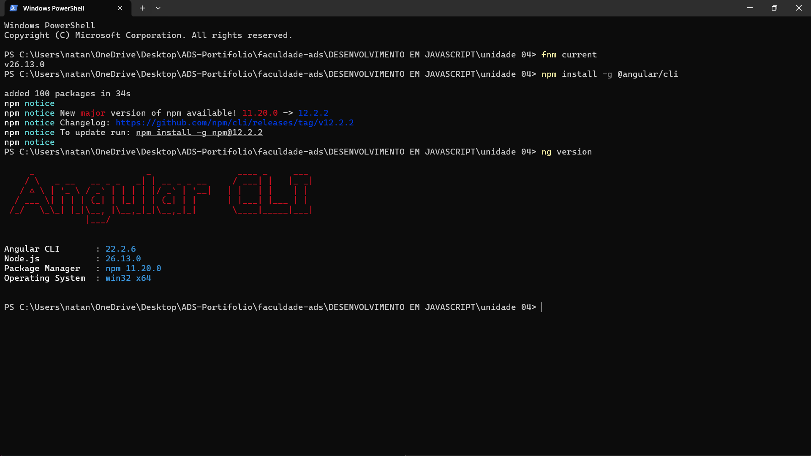
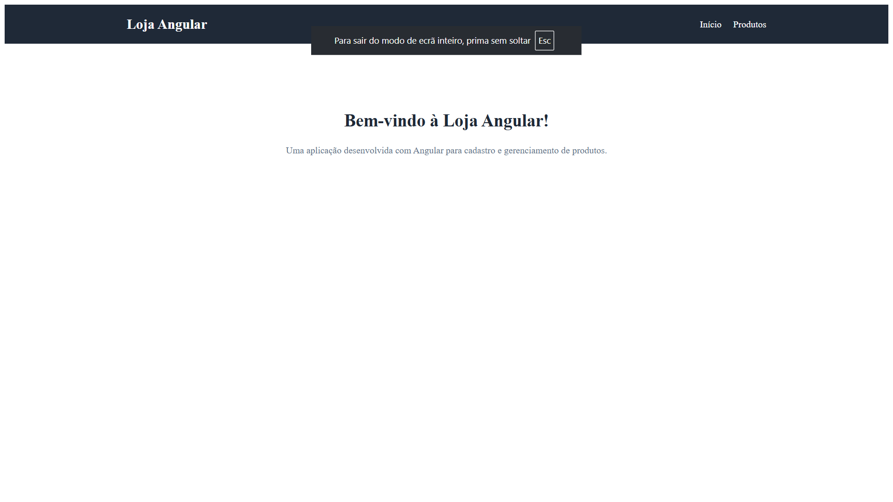
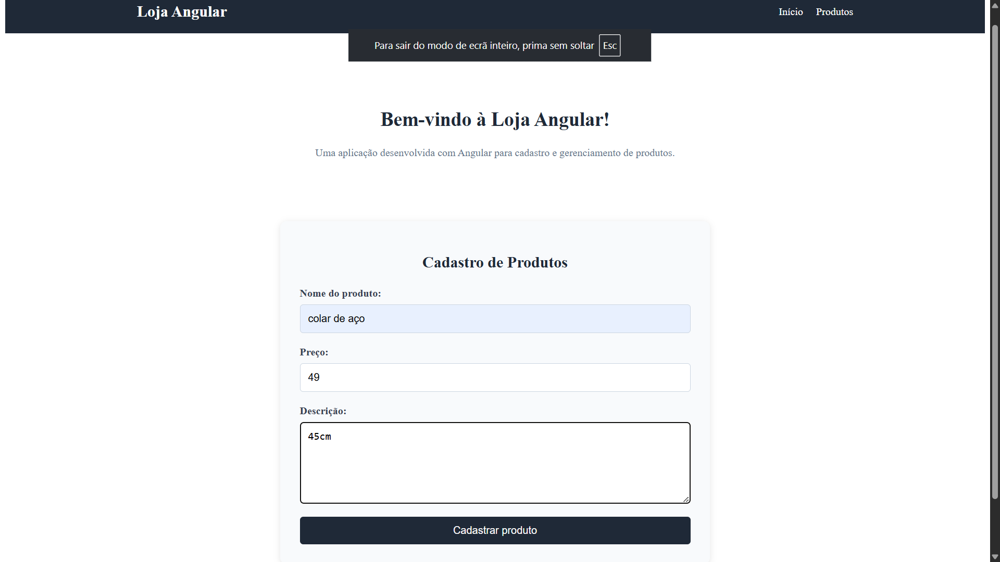
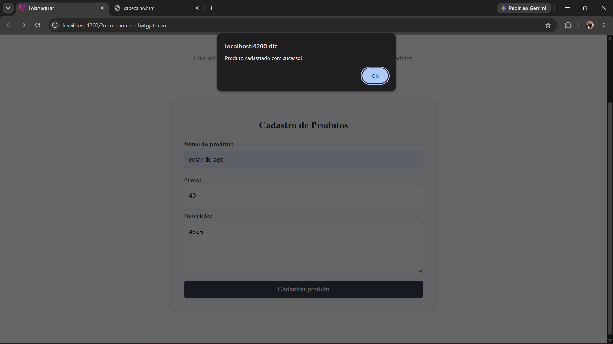
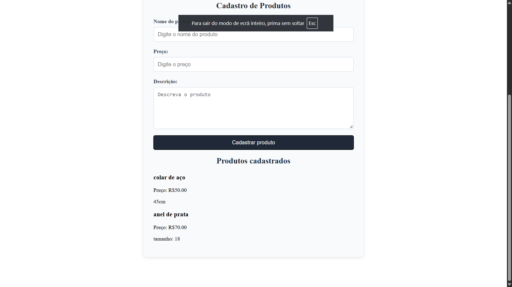
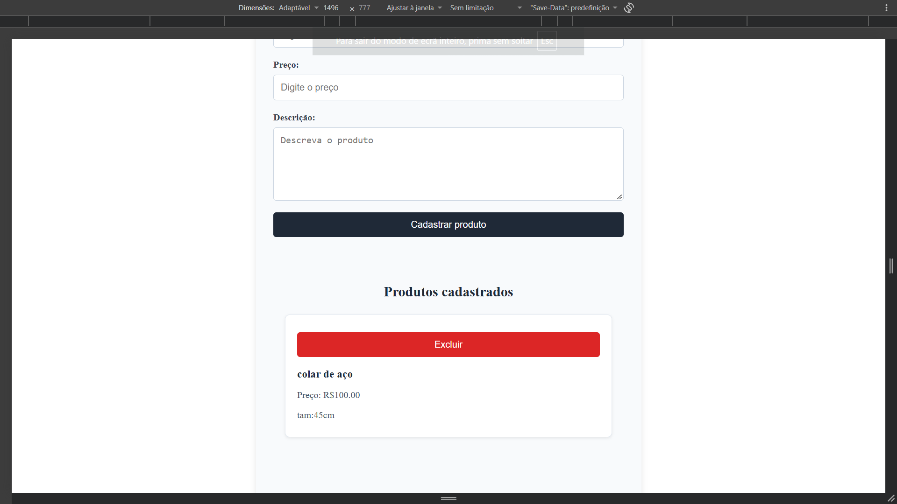
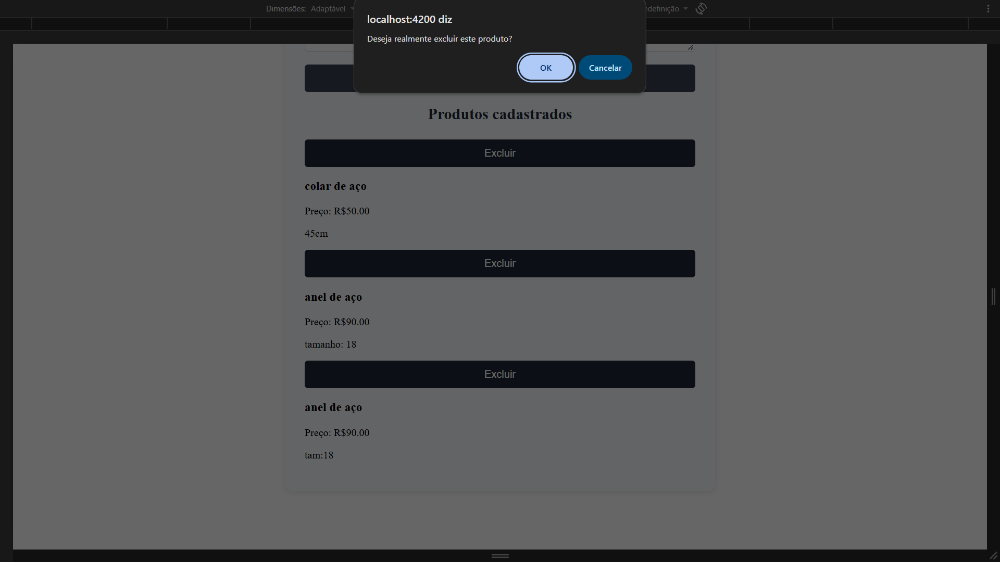
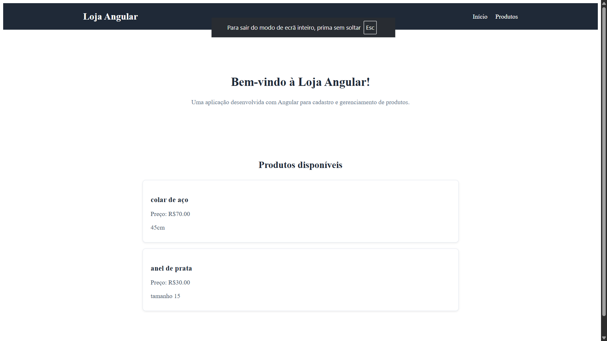
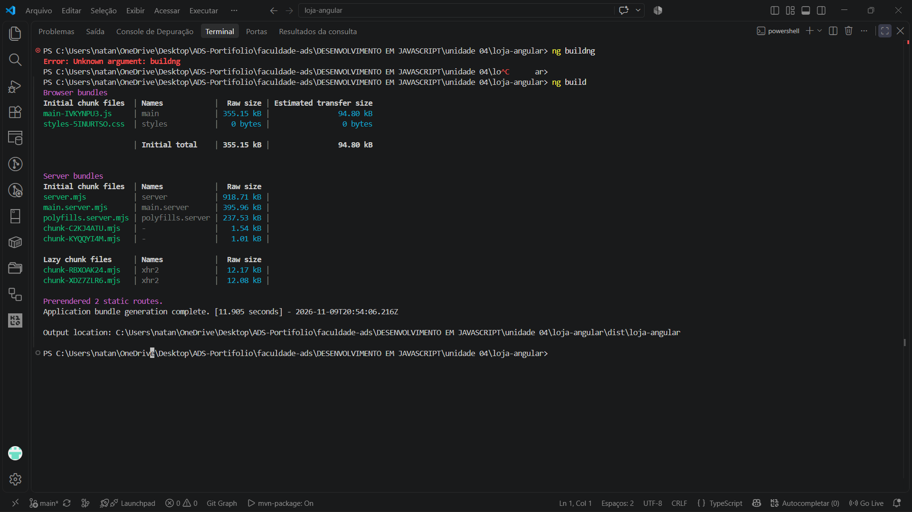

# Loja Angular

Aplicação web desenvolvida como atividade prática da disciplina **Desenvolvimento em JavaScript**, da graduação em Análise e Desenvolvimento de Sistemas da Universidade Anhanguera.

O projeto consiste em uma loja virtual simples, desenvolvida com Angular, permitindo cadastrar, visualizar e excluir produtos. Os dados são armazenados no navegador por meio do `localStorage`.

## 1. Objetivo do projeto

Desenvolver uma aplicação utilizando Angular, aplicando conceitos de componentes, módulos, rotas, formulários, vinculação de dados e armazenamento local.

## 2. Tecnologias utilizadas

- Angular
- TypeScript
- HTML5
- CSS3
- Node.js
- npm
- Visual Studio Code
- Git e GitHub
- localStorage

## 3. Funcionalidades

- Cadastro de produtos.
- Validação dos campos do formulário.
- Exibição dos produtos cadastrados.
- Exclusão de produtos.
- Formatação dos preços em Real (R$).
- Armazenamento dos dados no navegador.
- Navegação entre páginas utilizando Angular Router.
- Persistência dos registros após atualizar a página.

## 4. Estrutura dos componentes

A aplicação foi organizada em componentes para separar as responsabilidades:

| Componente | Responsabilidade |
|---|---|
| Cabecalho | Apresentação do título e menu de navegação. |
| CadastroProduto | Cadastro e exclusão de produtos. |
| ListaProdutos | Exibição dos produtos cadastrados. |
| App | Componente principal da aplicação. |

## 5. Rotas da aplicação

| Rota | Página |
|---|---|
| `/` | Página inicial e cadastro de produtos. |
| `/produtos` | Listagem dos produtos cadastrados. |

## 6. Como executar o projeto

É necessário ter o Node.js e o npm instalados.

Clone o repositório:

```bash
git clone https://github.com/NatanjSoares/ADS-PORTIFOLIO.git
```

Acesse a pasta do projeto:

```bash
cd "ADS-PORTIFOLIO/faculdade-ads/DESENVOLVIMENTO EM JAVASCRIPT/unidade 04/loja-angular"
```

Instale as dependências:

```bash
npm install
```

Inicie a aplicação:

```bash
npm start
```

Acesse pelo navegador:

```text
http://localhost:4200/
```

## 7. Evidências de desenvolvimento

As imagens a seguir apresentam os registros das etapas de desenvolvimento, implementação e testes da aplicação Loja Angular.

### Evidência 01 — Criação do projeto



### Evidência 02 — Estrutura do projeto


### Evidência 03 — Criação dos componentes


### Evidência 04 — Configuração das rotas



### Evidência 05 — Desenvolvimento do cadastro



### Evidência 06 — Cadastro de produtos



### Evidência 07 — Listagem de produtos



### Evidência 08 — Exclusão de produtos



### Evidência 09 — Armazenamento com localStorage



### Evidência 10 — Teste de navegação e aplicação


### Evidência 11 — Documentação do projeto



## 8. Repositório

O código-fonte completo está disponível no GitHub:

[ADS-PORTIFOLIO — Loja Angular](https://github.com/NatanjSoares/ADS-PORTIFOLIO/tree/main/faculdade-ads/DESENVOLVIMENTO%20EM%20JAVASCRIPT/unidade%2004/loja-angular)

## 9. Considerações finais

O desenvolvimento desta aplicação permitiu colocar em prática conceitos fundamentais do Angular, especialmente a organização por componentes, a configuração de rotas, a utilização de formulários e a persistência de dados com localStorage.

A atividade contribuiu para ampliar os conhecimentos em desenvolvimento front-end e na construção de aplicações web utilizando TypeScript e Angular.